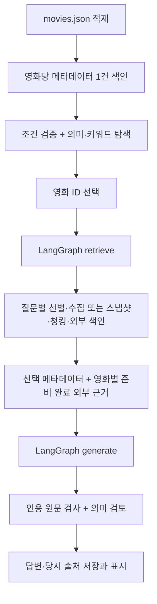

# Movie Lab — 영화와 현실 배경을 근거로 확인하기

영화를 자연어로 찾고 선택한 뒤 작품 정보와 현실 배경에 관한 질문을 출처와 함께 확인하는 개인 프로젝트다. 메타데이터·작품 속 묘사·현실 사실·사용자 주장·서비스 해석을 구분한다. 답변의 `[근거 N]`에서 실제 인용한 원문과 구절을 확인할 수 있다. 근거 부족을 거짓으로 판정하지 않는다.

**현재: UI 마무리·사용자 직접 점검 대기, 2026-10-22.** 생성 `gpt-4o-mini`·검토 `gpt-5.4-mini` 프로필을 유지한다. [이번 UI 범위·검증](artifacts/review_ui_finish/implementation_report.md)은 표시·입력 동작의 확인이며 저장 결과 재생을 새 모델 응답으로 취급하지 않는다. [사용자 직접 점검표](docs/USER_ACCEPTANCE.md)의 실제 결과는 전부 미실시이며, 사용자의 결과를 받은 뒤 최신 제출 ZIP을 구성한다. [앞선 표시 개선](artifacts/review_display/implementation_report.md)과 [실제 두 질문](artifacts/review_completion/implementation_report.md), [직전 구현·비교 기록](artifacts/review_upgrade/implementation_report.md)은 당시 증거로 보존한다.

- [통합 요구사항·증거표](docs/REQUIREMENTS.md): 구현 위치, 실제 확인과 미확인, 실패 → 수정 후 결과
- [사용자 직접 점검표](docs/USER_ACCEPTANCE.md): 절차·기대/실제 결과·증거·확인자·시각. 직접 실시하기 전에는 미실시
- [자기/동료·브라우저 점검](docs/PRESENTATION.md): 미확인 수동 절차 유지. 발표는 없으며 기존 원고 작업은 종료
- [수업 제출 구성](docs/SUBMISSION.md): 실제 요구와 준비/미준비 파일, 데이터 포함 판단
- [기존 Streamlit 실습 안내](docs/STREAMLIT_LAB.md): 기존 README의 실습 부분을 그대로 보존
- [업그레이드 계획](docs/UPGRADE_PLAN.md)과 [선필터 계획](docs/DISCOVERY_UPGRADE_PLAN.md)은 이전 설계 기록이다. 현재 구현·성공·실패는 위 최신 보고서와 통합표에 구분한다.

## 이용 순서

1. **자연어로 영화 찾기**에서 제목·감독·연도·장르를 입력하거나 사이드바의 **질문할 영화** 목록에서 고른다. 예시 버튼은 검색어만 채우며 **영화 탐색**을 눌러야 검색한다. 결과의 조건 근거를 읽고 **이 영화 선택**을 누른다.
2. 선택 영화의 **제목·연도·감독·상영 시간·장르·제공 평점/평가 수**를 확인한다. 동명 작품은 제목만으로 결정하지 않는다. 영화 ID·전체 출연진·원래 평점은 **영화 상세 정보**에, 줄거리는 별도의 스포일러 안내가 있는 접힌 영역에 있다. 제공 평점은 실시간 수치가 아니다.
3. **근거 기반 질문**(일반 모드) 또는 **작품·현실 배경 확인**을 선택하고 하단 질문창에 한 번 전송한다. 추천 질문 최대 세 개는 선택 영화에 실제 제공된 필드로 구성하며 **클릭은 질문창만 채운다.** 전송 전에 자유롭게 고칠 수 있고 영화 전환 시 미전송 초안은 비운다. 실제 전송 뒤 자료 확인 → 근거 검색 → 답변 작성·근거 검토가 이어진다. 백엔드가 작성/검토를 함께 알리는 구간을 가짜 개별 단계나 진행률로 나누지 않는다.
4. **답변에 사용한 근거**를 펼쳐 출처 제목·원문·인용 구절·종류·수집 방식·시점을 확인한다. 명확한 감독 메타데이터 항목은 **영화 정보 · 감독**으로 표시한다. 메타데이터의 감독/상영 시간 관련 원문 행을 먼저 보여주고 **전체 원래 인용**은 별도로 펼친다. 날짜가 없으면 미상이며 과거 답변 내용·판정과 당시 출처는 바꾸지 않는다.
5. 같은 탭에서 영화를 바꾸어 영화별 기록을 읽는다. 직전 업그레이드의 실제 브라우저에서 **A→B→A 복원·일반 rerun 무중복**을 확인했고 이번에는 재시연하지 않았다. **완전 새로고침·새 탭·서버 재시작 이후 영구 보존은 지원하지 않는다.** 과거 중단된 브라우저 기록은 당시 미확인으로 보존한다.

**고급 설정 · 자료 미리 준비**는 경로·수집 방식·캐시 갱신을 바꿀 때 사용한다. 평소에는 질문창 하나로 이용한다. 탐색·자료 준비·질문 제출에는 실제 요청이 발생할 수 있다. 단순 화면 조작은 이전 답변을 다시 생성하는 작업이 아니다.

저장소 상태와 대화 지우기는 사이드바의 접힌 **고급 설정 · 저장소 진단 / 대화 관리**에 있다. KOBIS는 대화 아래의 독립된 접힌 보조 영역이며 별도 키가 없어도 영화 탐색·질문은 이용할 수 있다. 화면은 Streamlit 기본 위젯과 로컬 공식 테마를 사용하고 외부 폰트·이미지·새 프론트엔드에 의존하지 않는다.

### 직접 점검용 정상 앱 실행

이미 `http://127.0.0.1:8501`의 정상 앱이 실행 중이면 그대로 이용하고 서버를 추가로 실행하지 않는다. 준비 당시 로컬 health는 `200/ok`였으며 질문 전송·모델 호출 검사는 하지 않았다. 저장 결과 재생 안내가 있는 화면은 직접 질문 점검에 사용하지 않는다.

서버가 종료된 뒤 다시 실행할 때는 프로젝트 루트에서 기존 실행기를 우선 사용한다. 실행기는 두 역할 값을 적용하고 종료 후 이전 값을 복원한다. 키는 기존 승인된 클라이언트의 dotenv 경로에서 읽는다.

```powershell
.\scripts\run_review_profile.ps1
```

PowerShell 실행 정책으로 PS1이 차단되면 전역 정책을 바꾸지 않고 **별도 PowerShell 터미널**에서 아래와 같이 실행한다. 경로가 기본값과 다를 때는 실행 전 `MOVIE_SNAPSHOT_PATH`를 실제 배포 ZIP 경로로 지정한다. 이 대안은 터미널을 닫아 역할 환경변수를 폐기한다.

```powershell
$env:GMS_GENERATION_MODEL = 'gpt-4o-mini'
$env:GMS_REVIEW_MODEL = 'gpt-5.4-mini'
.\venv\Scripts\python.exe -m streamlit run app.py --server.address=127.0.0.1 --server.port=8501 --server.headless=true --client.showErrorDetails=false
```

직접 점검은 **제공 스냅샷**, **성공 캐시 갱신 해제**로 시작한다. 같은 탭을 유지하며 완전 새로고침이나 강제 재색인 없이 [점검표](docs/USER_ACCEPTANCE.md)의 결과를 기록한다. 기존 준비 자료가 없는 새 환경에서는 아래 데이터 준비·최초 색인 절차가 먼저 필요하다.

## 환경과 설치

실행 환경은 Windows PowerShell, Python **3.12.9**, 프로젝트의 `venv/Scripts/python.exe`다. 기존 설치 조합과 pip check 기록을 유지하고 이번에는 패키지를 바꾸지 않았다.

| 패키지 | 기록된 버전 |
|---|---|
| Streamlit | 1.62.0 |
| openai / python-dotenv | 2.54.0 / 1.2.3 |
| langchain-core / langchain-openai | 1.6.0 / 1.4.3 |
| LangGraph / Chroma | 1.2.10 / 1.5.9 |
| requests | 2.34.2: 보존된 실습 명세 기준 |

[프로젝트 의존성](requirements-project.txt)은 기존 [실습 requirements.txt](requirements.txt)를 포함한다. PDF의 버전은 참고 환경이며 정상 조합을 표만 보고 강제 교체하지 않는다. 이번 UI 마무리의 [최종 전체 오프라인 검사](artifacts/review_ui_finish/final_tests.log)는 **225개·26.368초·OK**이며 외부 네트워크를 차단했다. [최신 검사 범위](artifacts/review_ui_finish/implementation_report.md)의 표시12개·UI19개·오류/출처4개는 일부 중복되는 관련 검사이며 총 개수로 합산하지 않는다. 과거 [환경·pip check](artifacts/review_upgrade/environment.json)의 충돌 없음과 [당시 전체209개](artifacts/review_upgrade/final_tests.log)는 이전 증거다. 이번 패키지 설치·교체·pip check 재실행·실제 모델 검사는 없다.

다음 명령은 **재현 안내이며 이번에 실행하지 않았다.** 기존 `venv`가 있으면 생성·설치를 반복하지 않는다. 새 환경이 필요할 때 프로젝트 루트에서 실행하고 resolver 충돌 시 임의로 버전을 바꾸지 않는다.

```powershell
py -3.12 -m venv venv
.\venv\Scripts\python.exe -m pip install --dry-run -r requirements-project.txt
.\venv\Scripts\python.exe -m pip install -r requirements-project.txt
.\venv\Scripts\python.exe -m pip check
```

## 데이터와 설정

검토 ZIP에는 전체 데이터와 로컬 색인이 없다. 이용 권한이 있는 별도 배포 자료를 준비한다.

```text
streamlit_lab/
  data/
    movies.json                 # 배포 메타데이터, 현재 검증본 964건
    movie_snapshots.zip         # 배포 ZIP을 이 이름으로 두거나 경로 설정
    runtime/                    # 실행 생성물, 검토 ZIP 제외
      chroma/                   # 메타데이터 Chroma와 설정 manifest
      documents/                # 영화별 외부 문서 Chroma
      document_cache/           # 성공 탐색·질문 선별·최신 본문 캐시
```

스냅샷 리더는 ZIP의 `movielab_wiki/wikipedia/*.json`을 읽는다. 배포 ZIP을 그대로 지정할 수 있고 전체 압축 해제는 필요 없다. 현재 `data/movies.json`은 있고 **기본 경로의 `data/movie_snapshots.zip`은 없다.** 기존 검증은 별도 배포 ZIP 경로를 인자로 사용했다. 실행 전 ZIP을 준비하거나 고급 설정에 실제 경로를 지정한다. 앱에 개인 PC 경로를 고정하지 않았다.

`.env`가 없을 때만 예시를 복사한 뒤 로컬 편집기로 값을 입력한다. 기존 키를 덮어쓰지 않는다.

```powershell
if (-not (Test-Path -LiteralPath .env)) { Copy-Item -LiteralPath .env.example -Destination .env }
```

| 설정 | 역할·기본값 |
|---|---|
| `GMS_KEY` | 필수 로컬 비밀키. 코드·로그·ZIP에 넣지 않는다. |
| `GMS_CHAT_MODEL` | 현재 기본 `gpt-4o-mini`. 수업의 유일한 강제 모델이라는 뜻은 아니다. |
| `GMS_GENERATION_MODEL`, `GMS_REVIEW_MODEL` | 생성/검토 역할별 선택. 빈 값이면 각각 `GMS_CHAT_MODEL`로 복귀. 기본값은 둘 다 기존 모델이다. |
| `GMS_EMBEDDING_MODEL` | 검증한 `text-embedding-3-small`; 기존 저장소 1536차원 |
| `MOVIES_DATA_PATH`, `MOVIE_INDEX_PATH` | `data/movies.json`, `data/runtime/chroma` |
| `MOVIE_SNAPSHOT_PATH` | `data/movie_snapshots.zip` |
| `DOCUMENT_INDEX_PATH`, `DOCUMENT_CACHE_PATH` | `data/runtime/documents`, `data/runtime/document_cache` |
| `DOCUMENT_CHUNK_SIZE`, `DOCUMENT_CHUNK_OVERLAP` | 기본 문자 수 900 / 120 |
| `RAG_TOP_K`, `RAG_CONTEXT_CHARS`, `RAG_MAX_PER_DOCUMENT` | 메타데이터 포함 최종 근거 최대 6개 / 전체 문맥 상한 14000자 / 문서별 최대 2개 |
| `WIKI_CONTACT` | 실시간 요청의 연락 가능한 이메일 또는 URL. 미설정 시 스냅샷 대체 경로 사용 |
| `KOBIS_API_KEY` | 별도 KOBIS 조회 키. 미설정이면 안내만 표시하고 영화 선택·RAG는 계속 동작한다. GMS 키와 다르다. |

기존 GMS 주소는 `https://gms.ssafy.io/gmsapi/api.openai.com/v1/`다. 클라이언트 생성 시 `python-dotenv`가 루트 `.env`를 `override=False`로 읽어 키를 전달하며 기존 프로세스 환경변수가 우선한다. **앱 최초 데이터 경로 판독은 클라이언트 생성보다 빠르므로** 기본값 외의 경로는 실행 전 PowerShell 환경변수로 지정한다. `.env`의 경로가 최초 화면부터 적용된다고 가정하지 않는다.

```powershell
# 경로를 바꿀 때만 지정. 상대 경로 기준은 프로젝트 루트.
$env:MOVIES_DATA_PATH = 'data/movies.json'
$env:MOVIE_SNAPSHOT_PATH = 'data/movie_snapshots.zip'
.\venv\Scripts\python.exe -m streamlit run app.py
```

VS Code 인터프리터는 [settings.json](.vscode/settings.json)에 있다. [Streamlit 설정](.streamlit/config.toml)은 통계 전송과 이메일 안내를 끈다. 환경변수 로딩과 Git 비밀파일 보호는 별개다. `.gitignore`만으로 이미 추적한 키가 제거되지는 않는다.

## 최초 색인·재사용·캐시 갱신

**기존 검증 저장소가 있으면 재색인 없이 앱을 실행한다.** 메타데이터 964건·외부 ready 청크 314개는 [최신 보존 기록](artifacts/review_director_field/store_after.json)의 관측값이며 앱에 고정한 개수가 아니다.

새 환경의 최초 색인은 실제 임베딩 요청을 사용한다. 아래는 이번에 실행하지 않은 재현 명령이다. 소량 성공을 확인한 뒤 같은 저장소에 나머지를 증분 추가한다. 지정 모델·차원은 기존 계정에서 확인한 조합이며 다른 권한이나 미래 지원을 보장하지 않는다.

```powershell
.\venv\Scripts\python.exe -X utf8 scripts\index_metadata.py --model text-embedding-3-small --dimensions 1536 --movie-id 157336 --movie-id 753091
.\venv\Scripts\python.exe -X utf8 scripts\index_metadata.py --verify-only --movie-id 157336 --movie-id 753091
.\venv\Scripts\python.exe -X utf8 scripts\index_metadata.py --model text-embedding-3-small --dimensions 1536
.\venv\Scripts\python.exe -X utf8 scripts\index_metadata.py --verify-only
```

`--verify-only`는 키·임베딩 요청 없이 ID·본문·저장 벡터를 검사한다. 일반 색인도 ID·내용 해시가 같으면 재임베딩하지 않고 저장 확인 문서부터 재개한다. 모델·차원·텍스트 버전이 다른 컬렉션을 그대로 재사용하지 않는다. 모델 변경과 색인 마이그레이션은 별도 작업이다.

외부 자료는 전체 영화 일괄 수집이 아니라 **선택 영화 질문별**로 준비한다. 고급 설정의 **제공 스냅샷**은 실시간 수집을 시도하지 않는다. 실시간 우선에서도 연락처 미설정·접근 실패·대기 초과 시 스냅샷으로 대체하며 둘 다 없으면 확보 근거로 부분 처리한다.

- 성공 캐시 기본 수명은 24시간이다. 실패·빈 결과를 영구 성공으로 저장하지 않는다.
- 원문 갱신: **고급 설정 → 자료 경로와 갱신 설정 → 성공 캐시를 갱신하고 원문을 다시 확인**을 선택하고 준비 또는 질문을 한 번 실행한다. 끝나면 해제한다. 추가 요청이 발생할 수 있다.
- 질문 관련성 선별 캐시와 문서 최신 본문 캐시는 분리한다. 다른 질문에서 같은 본문은 재사용하지만 옛 질문 캐시로 최신 본문을 되돌리지 않는다.
- 본문·청킹 설정 변경 시 새 청크 저장 성공 후 옛 청크를 정리한다. **과거 답변의 당시 출처는 변경하지 않는다.** 준비 캐시는 답변 캐시가 아니므로 새 질문에 옛 답변을 그대로 반환하지 않는다.

## KOBIS 날짜별 박스오피스

영화를 선택하기 전에도 **날짜별 국내 박스오피스 · KOBIS**를 열어 과거 날짜를 선택하고 조회할 수 있다. 제출 버튼을 눌렀을 때만 요청한다. 일별/누적 관객과 매출, 집계일·응답 범위·수집시점·공개 출처를 구분하고 누락은 미상으로 표시한다. 숫자 표시에 LLM을 사용하지 않는다. KOBIS 영화 코드와 TMDB ID는 별개이며 자동 매핑·카탈로그 추가·채팅 근거 연결은 하지 않는다.

**조회 결과 TTL 캐시는 기본 비활성(0초)**이다. 공식 약관에서 300초 재사용의 허용 근거를 확인하지 못해 변경했다. 같은 날짜라도 조회 버튼을 새로 누르면 새 HTTP 요청을 시작한다. 일반 rerun은 세션에 있는 현재 화면 결과 한 건만 재표시하며 서비스 조회를 실행하지 않는다. 파일·DB·LLM·RAG로 결과를 전달/저장하지 않는다. 이번에도 **키 미설정·실제 데이터 GET 0회**이며 실서비스 수치는 미확인이다. [최신 정책·공식 약관·15개 대체 검사](artifacts/review_completion/kobis/verification.md)를 따른다. 현재 화면의 임시 표시까지 포괄적으로 허가받았다고 단정하지 않는다.

## 데이터 흐름과 설계 이유



메타데이터만 필요한 일반 질문은 외부 준비를 생략한다. 문서 준비는 `retrieve` 안에서 재사용하는 파이프라인이며 별도 LangGraph 노드는 아니다.

| 단계 | 실제 구현·선택 이유 |
|---|---|
| 메타데이터 | [data.py](movie_lab/data.py)의 `load_movies`, `build_index_text`가 문자열 ID와 빈 필드를 정리한다. [index.py](movie_lab/index.py)는 `meta:{movie_id}`·내용 해시·설정 버전으로 중복과 재임베딩을 방지한다. |
| 탐색 | [discovery.py](movie_lab/discovery.py), [services.py](movie_lab/services.py)가 실제 필드로 적격 ID를 먼저 만들고 [index.py](movie_lab/index.py)가 그 ID 안에서 의미 Top-3를 검색한다. 기존 키워드 결합·최종 10개와 조건 재검증은 유지한다. 제목·미지원·빈 집합은 임베딩 전에 종료한다. 캐시는 조건·적격 ID·전체 관련 필드·검색/임베딩 설정별로 분리하고 읽은 결과도 검사한다. |
| 외부 자료 | [document_llm.py](movie_lab/document_llm.py)의 검색어/선별 역할을 분리하고 후보 ID·스키마를 검사한다. [wiki.py](movie_lab/wiki.py), [document_models.py](movie_lab/document_models.py)가 실시간/스냅샷과 작품 식별을 나눈다. 올바른 자체 문서를 우선하고 배경 문서에 영화 연도를 강제하지 않는다. |
| 청킹·캐시 | [document_pipeline.py](movie_lab/document_pipeline.py)는 질문 선별과 최신 본문 캐시를 분리한다. [external_index.py](movie_lab/external_index.py)는 문단·문장 경계와 영화·문서·본문·설정 해시를 사용한다. 수집 성공과 색인 성공은 별도다. |
| 검색·그래프 | [retrieval.py](movie_lab/retrieval.py)는 선택 메타데이터를 직접 포함하고 외부 검색에 `movie_id`·ready 필터, 중복 제거·문서별/문맥 상한을 적용한다. [rag.py](movie_lab/rag.py)의 실제 StateGraph는 `START → retrieve → generate → END`다. |
| 생성·검토 | [answering.py](movie_lab/answering.py)는 이번 근거·해당 영화 최근 대화를 전달한다. 이전 AI 답변은 사실 근거가 아니다. 구절 ID를 실제 원문에 매핑하고 번호·원문 포함·작품/현실 범위를 검사한다. **형식 통과와 주장·근거 의미 일치는 별개다.** |
| 특화 모드 | 코드의 `claim_id`별 `evidence_relation`, `service_reason_supported`를 한 묶음 요청으로 받는다. 판정과 관계가 맞고 이유가 지지된 항목만 유지한다. 실패 항목은 검토 보류, 다른 통과 항목은 보존한다. 출처 충돌에는 서로 다른 문서가 필요하며 실제 충돌 판정 검증은 남아 있다. |
| 감독 보완 | [director_check.py](movie_lab/director_check.py)가 명확한 긍정형 감독 명제·정확한 전체 이름·선택 ID·단일 감독·실제 감독 행이 대응할 때 근거 부족 초안을 검토용 제안으로 보완한다. **자동 통과가 아니며 기존 항목 검토를 거친다.** 부분명·별칭·번역·부정/조건·다른 역할·누락/복수 감독·ID/구절 불일치에 기권한다. 두 글자 한글 이름도 현재 보완 대상 밖이다. |
| 대화·출처 | [state.py](movie_lab/state.py)의 `threads_by_movie[movie_id]` 한 곳에 assistant `answer_id/content/sources`를 저장한다. [evidence.py](movie_lab/evidence.py)와 [app.py](app.py)는 당시 실제 인용 출처만 표시하며 과거 단일 `quote`와 복수 `quotes`를 지원한다. |

**채팅 모델**은 검색어 추출·선별·생성·별도 의미 검토, **임베딩 모델**은 문서/질문의 같은 1536차원 벡터 변환을 맡는다. 채팅 성공을 임베딩 성공으로 간주하지 않고 [별도 실제 검사](artifacts/review/gms_embedding_probe.json)를 했다. 모델 검토는 추가 검사이며 진실 보증이 아니다. 이름 문자열 레지스트리도 전세계 인물 ID나 완전한 별칭 사전이 아니다.

오류는 실패 단계와 안전한 분류로 안내한다. 의미 검색 실패 뒤에는 실제 확보한 메타데이터·로컬 외부 근거를 사용한다. 저장소 자체가 열리지 않으면 메타데이터로 부분 처리하고 근거가 전혀 없으면 생성을 건너뛴다. Wiki는 직렬 호출·타임아웃·제한 재시도·서버 `Retry-After`를 적용하고 허용 대기 초과 시 조기 재요청 대신 대체 경로로 전환한다.

### 컬렉션·프롬프트·설정의 실제 계약

메타데이터 컬렉션 이름은 `movie_metadata_v1_{설정해시}`다. 문서 ID는 `meta:{movie_id}`이며 메타필드는 `movie_id/title/original_title/year/director/genres/text_hash/text_version`이다. 컬렉션 설정에 임베딩 모델·차원·텍스트 버전을 대응시킨다. 본문은 제목·원제·연도·감독·장르·출연·줄거리 등 제공 필드를 사용한다.

외부 컬렉션은 `movie_external_v1_{설정해시}`다. 문서 ID는 정규화 URL 등의 해시, 청크 ID는 `ext:{generation}:{chunk_index}`이며 generation에 영화 ID·문서 ID·본문 해시·청킹 버전이 포함된다. 청크 메타필드는 `movie_id/document_id/title/url/source_kind/collected_at/body_hash/chunk_version/generation/chunk_index/ready`다. 검색 결과의 작품/배경 범위는 준비 단계의 작품 식별 결과를 함께 사용한다. 같은 문서가 여러 영화에 사용돼도 청크가 충돌하지 않는다.

| 프롬프트 역할 | 입력 → 실제 출력 |
|---|---|
| [검색어 추출](prompts/extract_queries.txt) | 선택 메타데이터·현재 질문·최근 대화 → `queries`, `focus`. 코드가 자체 영화 검색어도 포함한다. |
| [후보 선별](prompts/select_documents.txt) | 후보 제목·요약·질문 → `selected_ids`, `reasons[{candidate_id, reason}]`. 허용 후보 ID와 구조를 검사한다. |
| [근거 기반 생성](prompts/generate_answer.txt) | 이번 근거의 실제 구절 ID·질문·미검증 대화 → 일반 모드는 `facts[{text, citations[{passage_id}]}]`, `unconfirmed`; 확인 모드는 `checks[{scope, claim, verdict, reason, citations[{passage_id}]}]`. 근거 부족에는 빈 인용을 허용한다. |
| 별도 의미 검토 | [일반 답변](prompts/review_answer.txt)은 `reason/supported`, [확인 모드](prompts/review_verify.txt)는 `items[{claim_id,evidence_relation,service_reason_supported,reason}]`. 코드가 확인됨↔supports·상충↔contradicts·충돌↔conflicting와 이유 지지를 대조한다. |

900자 청크·120자 중복은 문단/문장 경계를 살리면서 인접 맥락을 남기는 현재 설계값이다. 메타데이터 포함 최종 근거 최대 6개·문서별 최대 2개는 한 문서의 겹치는 청크가 다른 주제를 밀어내는 것을 줄이고, 14000자 상한은 전달 문맥을 제한한다. **최적값을 실험으로 확정한 것은 아니다.** 값을 키우면 문맥과 중복·입력량이 늘 수 있고 줄이면 근거 누락 가능성이 있다. 이는 설계상의 예상이며 값별 실제 성능 비교는 미실시다. 청킹 변경은 새 저장 성공 후 구청크 정리를, 문서/질문 임베딩 변경은 설정 일치 확인을 요구한다.

## 역할별 모델 선택과 복귀

직전 동결 근거 비교는 기준 `gpt-4o-mini`, 후보 한 개 `gpt-5.4-mini`로 채팅 14회·실패/재시도 0이었다. 모델의 원래 초안·감독 보완·인용 검사·검토·최종 결과를 분리했다. 세 질문에서 생성 정확도 향상은 확인하지 못했고, 고정 검토 배치에서는 후보가 더 적절했으나 일부 검토가 오래 걸렸다. [당시 모델 비교 원본·한계](artifacts/review_upgrade/models/implementation_report.md)는 보존한다.

앞선 마무리에서 **생성 gpt-4o-mini·검토 gpt-5.4-mini 프로필을 정상 앱 두 질문으로 확인**했다. 이번에는 질문 없이 **실제 PS1 시작·정상 종료·이전 환경 복원**을 별도로 확인했다. [실행기 검증 범위](artifacts/review_display/launcher/implementation_report.md)를 따른다. `.\scripts\run_review_profile.ps1`로 실행할 수 있다. 이 실행기는 해당 앱 프로세스에만 역할을 지정하고 종료 후 호출 셸의 이전 두 값을 복원한다. `.env`나 코드의 기본 모델은 변경하지 않는다. 프로세스 환경변수가 `.env`보다 우선한다(`override=False`). 직접 지정/복귀하려면 다음과 같이 설정한 뒤 앱을 다시 실행한다.

```powershell
$env:GMS_GENERATION_MODEL = 'gpt-4o-mini'
$env:GMS_REVIEW_MODEL = 'gpt-5.4-mini'
.\venv\Scripts\python.exe -m streamlit run app.py
# 둘 다 기존 모델로 복귀한 후 앱 재실행
$env:GMS_GENERATION_MODEL = 'gpt-4o-mini'
$env:GMS_REVIEW_MODEL = 'gpt-4o-mini'
```

두 역할 변수를 비우면 기존 `GMS_CHAT_MODEL`을 사용한다. 현재 후보의 실제 수락 옵션은 `temperature=0`, `max_completion_tokens=1800`, `reasoning_effort=none`, strict JSON Schema였다. 다른 모델/옵션까지 검증한 것은 아니다.

## 확인 결과와 한계

- 964건 ID 재조회·프로세스 재시작·동일 데이터 재실행을 확인했다. 재실행 964건 유지·재임베딩 0건은 저장 정합성 증거이며 탐색 품질 전체의 증거는 아니다.
- 대표 탐색 3건의 기대작 순위는 의미 검색 5/8/46에서 결합 탐색 1/1/1로 개선됐다. 고정된 세 질문의 관측이며 광범위 정확도 평가가 아니다.
- 과거 브라우저 시연에서 인터스텔라의 복수 구절은 성공했고 더 문의 감독은 근거 부족으로 남았다. 당시 감독 보완 후 성공은 CLI 기록이며 그 옛 브라우저 결과를 바꾸지 않는다. 이후 **이번 새 브라우저 시연**에서는 두 질문과 복원을 별도로 확인했다.
- 감독 보완 단계의 이전 CLI 혼합 질문은 두 항목을 수락했고 전체 17.858초였다. **당시 단 1회 관측이며 평균·보장이 아니다.** [이전 초안·구절·검토 기록](artifacts/review_director_field/actual_case.json). 이번 브라우저 및 모델 비교는 별도 최신 보고서에 있다.
- **근거 부족**은 확인 자료가 없다는 뜻이며 거짓이 아니다. **검토 보류**는 검토 계약이 맞지 않아 단정하지 않는 상태다. **API 실패**는 기술적 호출 실패다. 세 상태를 사실 검증 성공으로 합치지 않는다.
- 직전 브라우저의 혼합 질문과 A→B→A는 실제로 확인했다. 당시 짧은 검색 입력의 최종 순위는 1/1/1/2로 양쪽 같았다. 이번에는 검토 후보 프로필의 두 답변을 확인했고, **정확한 추가 검색 원문에서 인터스텔라 순위는 A 5→B 3**이었다. B 질문 임베딩은 이번에도 502였으며 저장 근거로 답변·검토했다. 기준 검토 모델의 과거 고정 도전 두 항목 오수락 기록은 그대로 남긴다. 광범위 정확도·실제 출처 충돌 판정·인물 동일성 일반화·전체 이용 조건은 미확인이다. [항목별 범위](docs/REQUIREMENTS.md)

## 검토·제출

제출 기준본 정리 당시의 경로·문서 링크·코드 보존 확인은 [기존 문서 기록](artifacts/review_submission_baseline/document_checks.json)에 있다. 이후 업그레이드 준비의 변경·보존 확인은 [별도 기록](artifacts/review_upgrade_preparation/preparation_checks.json)에 둔다. 그 준비 단계에서는 생성·전체 검사를 하지 않았다. 직전 실제 모델 비교·209개 검사는 [업그레이드 보고서](artifacts/review_upgrade/implementation_report.md), 이번 프로필 적용·정확 원문 확인·KOBIS 정책은 [마무리 보고서](artifacts/review_completion/implementation_report.md)로 구분한다. 이번에는 새 ZIP을 만들지 않았다.

**검토 ZIP은 수업 제출 완료를 뜻하지 않는다.** 구성·누락 자료는 [제출 구성표](docs/SUBMISSION.md)에 모았다. 키·`.env`·가상환경·Chroma·전체 배포 데이터는 검토 ZIP에서 제외한다. [기존 이용 조건 기록](artifacts/review_director_field/source_conditions.md)은 위키 발췌 표시와 남은 TMDB 재배포 조건·개별 문서 예외를 설명한다. 이번에는 [KOBIS 공식 이용 조건](artifacts/review_upgrade/kobis/verification.md)을 별도로 확인했고 기존 TMDB/위키의 이용 허락은 새로 받지 않았다. 외부 업로드·Git push·제출은 하지 않았다.
